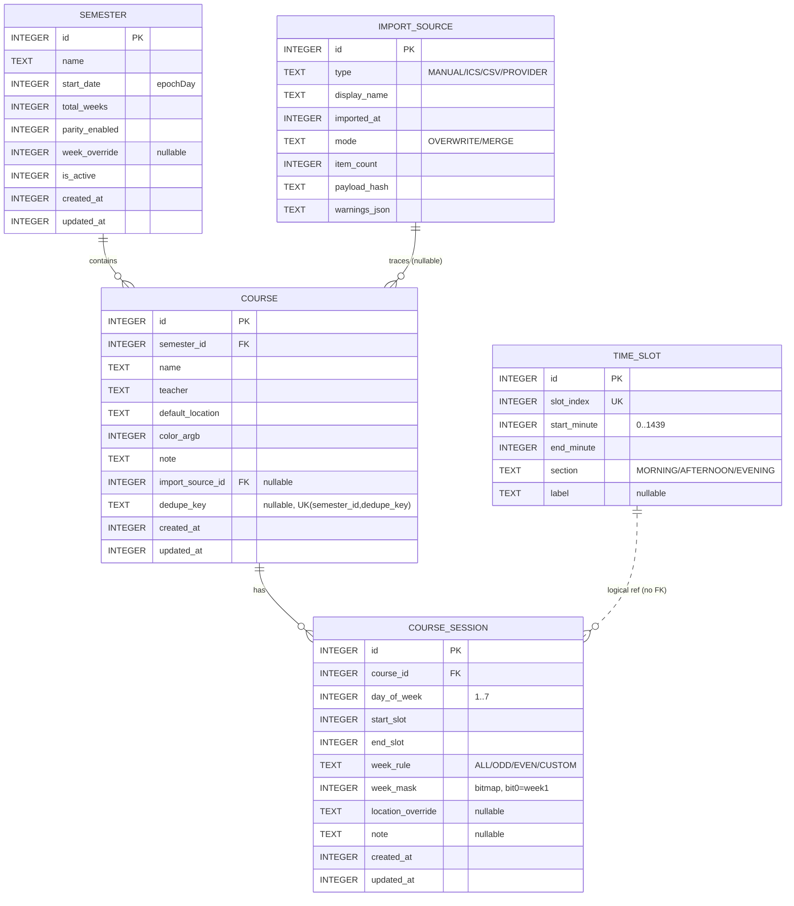

# 03 · 项目目录结构与数据库设计

## 一、目录结构（第二阶段将按此逐个落地）

```
D:\xiangmu\
├── settings.gradle.kts
├── build.gradle.kts                    # 根：插件版本统一管理
├── gradle.properties
├── gradle\libs.versions.toml           # Version Catalog（版本集中声明）
├── local.properties                    # sdk.dir（本机生成，勿提交）
├── .gitignore
└── app\
    ├── build.gradle.kts
    ├── proguard-rules.pro
    └── src\
        ├── main\
        │   ├── AndroidManifest.xml
        │   ├── assets\
        │   │   └── template.csv                    # CSV 导入模板
        │   ├── res\
        │   │   ├── values\strings.xml colors.xml themes.xml
        │   │   ├── values-night\themes.xml
        │   │   ├── xml\today_widget_info.xml       # 小组件元数据（尺寸/预览/更新周期）
        │   │   ├── xml\backup_rules.xml  data_extraction_rules.xml
        │   │   ├── drawable\ic_launcher_*.xml  widget_preview.xml
        │   │   └── mipmap-*\...
        │   └── java\com\classflow\timetable\
        │       ├── ClassFlowApp.kt                  # @HiltAndroidApp + WorkManager Configuration.Provider
        │       ├── MainActivity.kt                  # @AndroidEntryPoint，承载 NavHost
        │       │
        │       ├── core\
        │       │   ├── time\DateTimeProvider.kt      # 可注入的「现在」，便于测试
        │       │   ├── time\WeekMath.kt              # 周次换算（floorDiv）
        │       │   ├── ext\FlowExt.kt                # debounce/combine 工具
        │       │   └── ui\ColorUtil.kt  EmptyState.kt  LoadingBox.kt  ErrorBox.kt
        │       │
        │       ├── di\
        │       │   ├── DatabaseModule.kt             # Room + DAO 提供
        │       │   ├── RepositoryModule.kt           # 接口 → 实现 绑定
        │       │   ├── AppModule.kt                  # DataStore、Clock、Dispatcher
        │       │   └── Qualifiers.kt                 # @IoDispatcher / @DefaultDispatcher
        │       │
        │       ├── domain\
        │       │   ├── model\
        │       │   │   ├── Semester.kt
        │       │   │   ├── TimeSlot.kt  SlotSection.kt
        │       │   │   ├── Course.kt
        │       │   │   ├── CourseSession.kt
        │       │   │   ├── WeekMask.kt  WeekRuleType.kt
        │       │   │   ├── ImportSource.kt  ImportSourceType.kt  ImportMode.kt
        │       │   │   ├── Conflict.kt
        │       │   │   ├── DayCourse.kt              # 今日/某日一节课的展示模型
        │       │   │   └── WidgetModel.kt
        │       │   ├── repository\
        │       │   │   ├── TimetableRepository.kt    # 读 Flow / 写 suspend
        │       │   │   └── SettingsRepository.kt     # DataStore 偏好
        │       │   ├── usecase\
        │       │   │   ├── ResolveCurrentWeekUseCase.kt
        │       │   │   ├── GetDayCoursesUseCase.kt
        │       │   │   ├── GetWeekCoursesUseCase.kt
        │       │   │   ├── GetCourseDetailUseCase.kt
        │       │   │   ├── SaveCourseUseCase.kt
        │       │   │   ├── DeleteCourseUseCase.kt
        │       │   │   ├── DetectConflictsUseCase.kt
        │       │   │   ├── BuildWidgetModelUseCase.kt
        │       │   │   ├── ExportBackupUseCase.kt
        │       │   │   └── ImportBackupUseCase.kt
        │       │   ├── import\
        │       │   │   ├── IcsParser.kt               # 纯 Kotlin，无 Android 依赖
        │       │   │   ├── CsvParser.kt
        │       │   │   ├── ImportPreview.kt           # PreviewItem + Warning
        │       │   │   └── ImportCommitUseCase.kt     # 覆盖/合并 + 事务
        │       │   └── provider\
        │       │       ├── TimetableProvider.kt       # 【扩展点】学校教务适配器接口
        │       │       ├── MockTimetableProvider.kt
        │       │       └── ProviderRegistry.kt
        │       │
        │       ├── data\
        │       │   ├── local\db\
        │       │   │   ├── AppDatabase.kt             # version=1，导出 schema 到 app/schemas
        │       │   │   ├── entity\SemesterEntity.kt  TimeSlotEntity.kt
        │       │   │   │        CourseEntity.kt  CourseSessionEntity.kt  ImportSourceEntity.kt
        │       │   │   ├── dao\SemesterDao.kt  TimeSlotDao.kt  CourseDao.kt
        │       │   │   │      CourseSessionDao.kt  ImportSourceDao.kt
        │       │   │   ├── converter\Converters.kt    # LocalDate/LocalTime/WeekRule/枚举
        │       │   │   └── seed\DefaultData.kt        # 12 节默认时间 + 默认学期
        │       │   ├── mapper\EntityMappers.kt
        │       │   ├── repository\TimetableRepositoryImpl.kt
        │       │   ├── repository\SettingsRepositoryImpl.kt   # DataStore
        │       │   ├── backup\BackupEnvelope.kt  BackupManager.kt
        │       │   └── csv\CsvTemplateProvider.kt
        │       │
        │       ├── ui\
        │       │   ├── theme\Color.kt  Type.kt  Theme.kt  ThemeMode.kt
        │       │   ├── navigation\
        │       │   │   ├── Routes.kt                  # 类型安全路由定义
        │       │   │   └── ClassFlowNavHost.kt
        │       │   ├── components\
        │       │   │   ├── CourseCard.kt              # 今日卡片（含颜色条）
        │       │   │   ├── WeekGrid.kt                # 周课表网格（含节次栏/时间线）
        │       │   │   ├── WeekPicker.kt              # 周次选择器
        │       │   │   ├── SlotRangePicker.kt          # 起始结/结束节
        │       │   │   ├── WeekRuleEditor.kt           # 全部/单/双/指定
        │       │   │   ├── ColorPickerRow.kt
        │       │   │   └── ConflictBanner.kt
        │       │   └── screen\
        │       │       ├── today\TodayScreen.kt  TodayViewModel.kt  TodayUiState.kt
        │       │       ├── week\WeekScreen.kt  WeekViewModel.kt
        │       │       ├── detail\CourseDetailScreen.kt  CourseDetailViewModel.kt
        │       │       ├── edit\CourseEditScreen.kt  CourseEditViewModel.kt
        │       │       ├── importflow\ImportScreen.kt  ImportPreviewScreen.kt
        │       │       │              ImportViewModel.kt  ImportPreviewViewModel.kt
        │       │       ├── settings\SettingsScreen.kt  SettingsViewModel.kt
        │       │       ├── semester\SemesterSettingsScreen.kt  ...
        │       │       ├── slots\SlotSettingsScreen.kt  SlotSettingsViewModel.kt
        │       │       ├── backup\BackupScreen.kt  BackupViewModel.kt
        │       │       └── help\WidgetGuideScreen.kt   PrivacyScreen.kt
        │       │
        │       ├── widget\
        │       │   ├── TodayWidget.kt                 # GlanceAppWidget
        │       │   ├── TodayWidgetReceiver.kt         # GlanceAppWidgetReceiver
        │       │   ├── TodayWidgetContent.kt          # 分尺寸 UI
        │       │   ├── WidgetEntryPoint.kt            # @EntryPoint 拿 Repository
        │       │   └── WidgetRefresher.kt             # 去抖 + Mutex 的刷新入口
        │       │
        │       ├── notification\
        │       │   ├── ReminderScheduler.kt           # AlarmManager 精确/降级
        │       │   ├── ReminderReceiver.kt
        │       │   ├── NotificationHelper.kt          # 渠道 + 权限检查
        │       │   └── SystemEventReceiver.kt         # BOOT/TIME_SET/TIMEZONE/DATE_CHANGED
        │       │
        │       └── worker\
        │           ├── DailyRefreshWorker.kt          # @HiltWorker
        │           └── DailyRefreshScheduler.kt       # 自链 OneTime + Periodic 兜底
        │
        ├── test\java\com\classflow\timetable\          # 纯 JVM 单测
        │   ├── WeekMaskTest.kt
        │   ├── WeekMathTest.kt
        │   ├── ConflictDetectorTest.kt
        │   ├── IcsParserTest.kt
        │   ├── CsvParserTest.kt
        │   ├── BuildWidgetModelTest.kt
        │   ├── ImportCommitTest.kt
        │   └── fake\FakeTimetableRepository.kt
        │
        └── androidTest\java\com\classflow\timetable\
            ├── dao\CourseSessionDaoTest.kt
            ├── dao\CascadeDeleteTest.kt
            └── ui\TodayScreenTest.kt  WeekScreenTest.kt
```

> `app\schemas\` 会由 Room 的 `room.schemaLocation` 生成，第二阶段的每个 `.kt` 文件都会给完整代码，不留 `TODO`。

## 二、数据库表设计（Room，version = 1）

### 2.1 实体关系



### 2.2 DDL（等价 Room 生成的 SQL，第二阶段以 Room Entity 为准）

```sql
PRAGMA foreign_keys = ON;

CREATE TABLE IF NOT EXISTS `semester` (
  `id`             INTEGER PRIMARY KEY AUTOINCREMENT NOT NULL,
  `name`           TEXT    NOT NULL,
  `start_date`     INTEGER NOT NULL,              -- LocalDate.toEpochDay()
  `total_weeks`    INTEGER NOT NULL,              -- 1..60
  `parity_enabled` INTEGER NOT NULL DEFAULT 1,    -- 是否启用单双周（导入/编辑器提示用）
  `week_override`  INTEGER,                       -- 手动指定的当前周，NULL=自动推导
  `is_active`      INTEGER NOT NULL DEFAULT 0,    -- 1 表示当前学期
  `created_at`     INTEGER NOT NULL,
  `updated_at`     INTEGER NOT NULL
);
CREATE INDEX IF NOT EXISTS `idx_semester_active` ON `semester`(`is_active`);

CREATE TABLE IF NOT EXISTS `time_slot` (
  `id`           INTEGER PRIMARY KEY AUTOINCREMENT NOT NULL,
  `slot_index`   INTEGER NOT NULL,                -- 第几节，1..12
  `start_minute` INTEGER NOT NULL,                -- 距 00:00 的分钟数，8:00 => 480
  `end_minute`   INTEGER NOT NULL,                -- 8:45 => 525
  `section`      TEXT    NOT NULL,                -- MORNING / AFTERNOON / EVENING
  `label`        TEXT
);
CREATE UNIQUE INDEX IF NOT EXISTS `idx_slot_index` ON `time_slot`(`slot_index`);

CREATE TABLE IF NOT EXISTS `import_source` (
  `id`             INTEGER PRIMARY KEY AUTOINCREMENT NOT NULL,
  `type`           TEXT    NOT NULL,              -- MANUAL / ICS / CSV / PROVIDER
  `display_name`   TEXT    NOT NULL,              -- 文件名 / providerId / "手动录入"
  `imported_at`    INTEGER NOT NULL,
  `mode`           TEXT    NOT NULL,              -- OVERWRITE / MERGE
  `item_count`     INTEGER NOT NULL DEFAULT 0,
  `payload_hash`   TEXT,                          -- 文件内容 sha1，用于「同一文件重复导入」提示
  `warnings_json`  TEXT                           -- 解析告警数组（JSON）
);
CREATE INDEX IF NOT EXISTS `idx_import_at` ON `import_source`(`imported_at` DESC);

CREATE TABLE IF NOT EXISTS `course` (
  `id`               INTEGER PRIMARY KEY AUTOINCREMENT NOT NULL,
  `semester_id`      INTEGER NOT NULL,
  `name`             TEXT    NOT NULL,
  `teacher`          TEXT,
  `default_location` TEXT,
  `color_argb`       INTEGER NOT NULL,
  `note`             TEXT,
  `import_source_id` INTEGER,
  `dedupe_key`       TEXT,
  `created_at`       INTEGER NOT NULL,
  `updated_at`       INTEGER NOT NULL,
  FOREIGN KEY(`semester_id`)      REFERENCES `semester`(`id`)       ON DELETE CASCADE,
  FOREIGN KEY(`import_source_id`) REFERENCES `import_source`(`id`)  ON DELETE SET NULL
);
CREATE INDEX IF NOT EXISTS `idx_course_semester` ON `course`(`semester_id`);
CREATE UNIQUE INDEX IF NOT EXISTS `idx_course_dedupe` ON `course`(`semester_id`, `dedupe_key`);
-- SQLite 唯一索引中 NULL 互不冲突，因此手动录入（dedupe_key=NULL）不受限制

CREATE TABLE IF NOT EXISTS `course_session` (
  `id`                INTEGER PRIMARY KEY AUTOINCREMENT NOT NULL,
  `course_id`         INTEGER NOT NULL,
  `day_of_week`       INTEGER NOT NULL,           -- 1=周一 ... 7=周日
  `start_slot`        INTEGER NOT NULL,
  `end_slot`          INTEGER NOT NULL,           -- >= start_slot
  `week_rule`         TEXT    NOT NULL,           -- ALL / ODD / EVEN / CUSTOM
  `week_mask`         INTEGER NOT NULL,           -- 位图，bit0=第1周
  `location_override` TEXT,
  `note`              TEXT,
  `created_at`        INTEGER NOT NULL,
  `updated_at`        INTEGER NOT NULL,
  FOREIGN KEY(`course_id`) REFERENCES `course`(`id`) ON DELETE CASCADE
);
CREATE INDEX IF NOT EXISTS `idx_session_course` ON `course_session`(`course_id`);
CREATE INDEX IF NOT EXISTS `idx_session_day_slot` ON `course_session`(`day_of_week`, `start_slot`);
```

### 2.3 为什么这样设计（关键取舍）

| 取舍 | 决定 | 理由 |
|------|------|------|
| 节次是否 FK 到 `time_slot.id` | **不建 FK**，只存 `slot_index` | 用户编辑节次时间（改开始时间、删一节）时，不该让历史课程数据被级联破坏；`slot_index` 是逻辑序号，改时间不影响关联 |
| 当前周存哪 | `semester.week_override`（可空） | 自动推导是主流，手动覆盖是例外；存 nullable 列比建表轻 |
| `is_active` 唯一性 | 应用层保证 + 事务 | Room 不支持 partial unique index；切换时在事务里先 `UPDATE ... SET is_active=0` 再置 1 |
| 颜色 | `ARGB` 存 `INTEGER`（Long） | 允许 ICS 导入自动配色；UI 用 `Color(colorArgb)` |
| 课程 vs 时段 | 拆两表 | 一门课多时段（同一门课周一 3-4 节、周三 5-6 节）必须共用课程名/教师/颜色，避免重复录入 |
| 删除语义 | `course` 删除级联 `course_session` | 用户删课期望时段一起消失；学期删除级联课程同理 |
| `CourseSession` 是否带 `semester_id` 冗余 | 不带 | 通过 `course.semester_id` 关联，避免双写不一致 |

### 2.4 常用查询（含位图下沉）

```sql
-- 1) 某天（周四）所有时段
SELECT s.*, c.name, c.teacher, c.color_argb,
       COALESCE(s.location_override, c.default_location) AS location
FROM course_session s JOIN course c ON c.id = s.course_id
WHERE s.day_of_week = 4 AND c.semester_id = :semesterId;

-- 2) 只看第 7 周要上的（位图查询，bit = 1 << 6）
SELECT * FROM course_session
WHERE week_mask & :weekBit != 0 AND day_of_week = :dow;

-- 3) 冲突检测（同天 + 节次相交 + 周次相交）
SELECT * FROM course_session
WHERE day_of_week = :dow
  AND start_slot <= :newEnd AND :newStart <= end_slot
  AND (week_mask & :newMask) != 0
  AND course_id != :selfCourseId;
```
> 实际实现里 2)、3) 走 DAO 拿「当天全部时段」后在内存做位运算（数据量小、可单测）；上面 SQL 保留为可选优化路径。

### 2.5 类型转换器

```kotlin
class Converters {
    @TypeConverter fun localDateToLong(v: LocalDate?): Long? = v?.toEpochDay()
    @TypeConverter fun longToLocalDate(v: Long?): LocalDate? = v?.let(LocalDate::ofEpochDay)
    @TypeConverter fun localTimeToInt(v: LocalTime?): Int? = v?.let { it.hour * 60 + it.minute }
    @TypeConverter fun intToLocalTime(v: Int?): LocalTime? = v?.let { LocalTime.of(it / 60, it % 60) }
    @TypeConverter fun weekRuleToStr(v: WeekRuleType): String = v.name
    @TypeConverter fun strToWeekRule(v: String): WeekRuleType = WeekRuleType.valueOf(v)
    @TypeConverter fun sectionToStr(v: SlotSection): String = v.name
    @TypeConverter fun strToSection(v: String): SlotSection = SlotSection.valueOf(v)
}
```

### 2.6 种子数据（首次启动写入，事务内）

- `time_slot`：12 节默认时间
  | 节 | 时间 | 段 |  | 节 | 时间 | 段 |
  |----|------|----|---|----|------|----|
  | 1 | 08:00-08:45 | 上午 |  | 7 | 16:00-16:45 | 下午 |
  | 2 | 08:55-09:40 | 上午 |  | 8 | 16:55-17:40 | 下午 |
  | 3 | 10:00-10:45 | 上午 |  | 9 | 19:00-19:45 | 晚上 |
  | 4 | 10:55-11:40 | 上午 |  | 10 | 19:55-20:40 | 晚上 |
  | 5 | 14:00-14:45 | 下午 |  | 11 | 20:50-21:35 | 晚上 |
  | 6 | 14:55-15:40 | 下午 |  | 12 | 21:45-22:30 | 晚上 |
- `semester`：名「当前学期」，`start_date` = 最近一个周一（相对安装日），`total_weeks` = 20，`is_active` = 1。
  > 用「最近一个周一」而不是写死某个日期，避免首次打开就是第 -30 周。

### 2.7 迁移策略

- v1 定稿后，任何字段变更必须写 `Migration(1, 2)` 并配 `MigrationTest`，**禁止 `fallbackToDestructiveMigration()`**（会静默清空用户课表）。
- `AppDatabase` 导出 schema 到 `app/schemas`，纳入版本管理，供迁移测试与代码审查。

---

## 三、DataStore 偏好（非表数据）

| Key | 类型 | 默认 | 用途 |
|-----|------|------|------|
| `theme_mode` | String | `SYSTEM` | SYSTEM / LIGHT / DARK |
| `dynamic_color` | Boolean | true | Android 12+ 动态取色 |
| `reminder_enabled` | Boolean | true | 课前提醒总开关 |
| `reminder_minutes` | Int | 15 | 提前分钟数（5/10/15/20/30） |
| `widget_max_items` | String | `AUTO` | 小组件条数：AUTO / FIXED_3 / FIXED_6 |
| `onboarding_done` | Boolean | false | 是否看过小组件引导 |
| `last_backup_at` | Long | 0 | 上次备份时间（提醒用户备份） |
| `current_semester_id` | Long | -1 | 冗余缓存，加速启动读取（与 `semester.is_active` 保持一致） |
